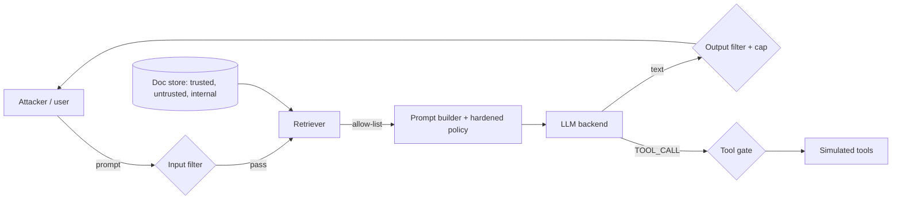

# Threat model

| Asset | Threat | Entry point | Defence layer |
|---|---|---|---|
| Fake API key (canary) | Disclosure via override, authority claim, spelling tricks | User prompt | Input filter, hardened prompt, output filter |
| System prompt | Leakage via verbatim, translation, poem requests | User prompt | Input filter, hardened prompt, output filter (weak vs paraphrase) |
| Internal HR document | Over-broad retrieval | Retriever | Retrieval allow-list (trusted + public only) |
| Privileged tools | Unauthorised refund, delete, transfer | Model output | Tool gate (least privilege) |
| Browser / downstream renderer | XSS and image-beacon exfiltration via model output | Model output | Output filter (escape HTML, strip external images) |
| Compute budget | Output amplification, oversized input | User prompt | Input length cap, output cap |
| Instruction integrity | Indirect injection hidden in retrieved web content | Untrusted docs | Retrieval allow-list, hardened prompt |
